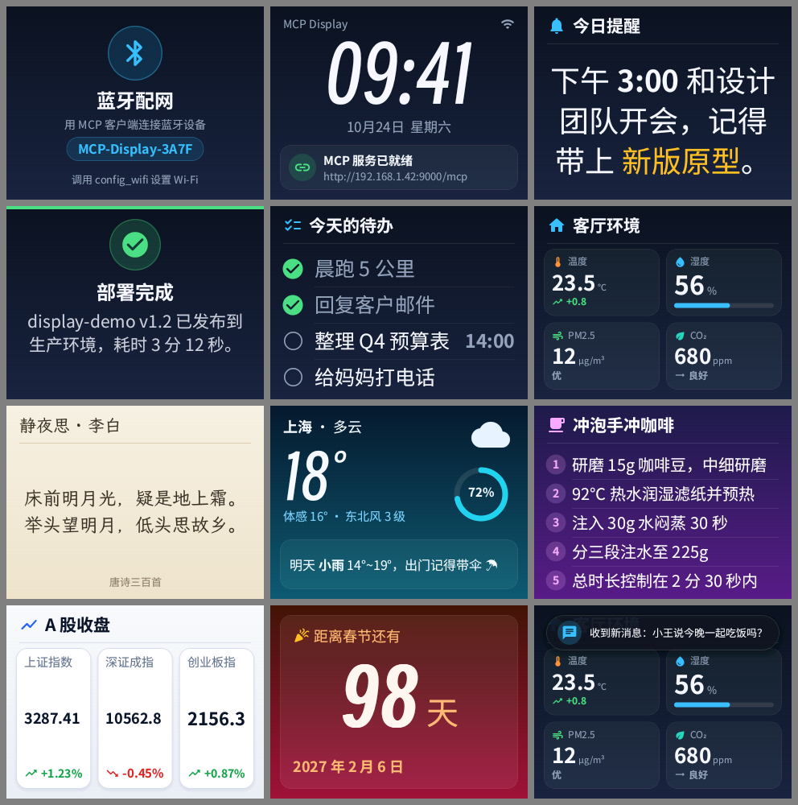

# ESP32 MCP Display

ESP32-S3 + 2.4 寸 320×240 彩屏信息屏。通过 BLE 上的 MCP 配网，联网后启动 HTTP MCP
服务，让 AI 客户端把文字、通知、列表、数据指标等内容以排版良好的方式显示到屏幕上，完整支持中文。



## 特性

- **MCP 配网**：开机即启动 BLE MCP（[ESP-MCP / esp-mcp-bootstrap](https://github.com/solnera/esp-mcp-bootstrap)），
  用 `config_wifi` 下发 Wi-Fi，连上后自动启动 HTTP MCP（`http://<ip>:9000/mcp`，并通过 mDNS
  广播 `_mcp._tcp`）。Wi-Fi 凭据保存在 NVS，重启自动重连。
- **矢量字体实时渲染**：设备端用 stb_truetype 光栅化 OpenType 字体，任意字号、抗锯齿，
  无需预先生成点阵。内置思源黑体（常规/粗体）、霞鹜文楷、得意黑三种中文字体 + Material 图标字体，
  覆盖 GB2312 全部 6763 个汉字。
- **自动排版**：自动选择能放下的最大字号；中文按字断行并遵守避头尾规则；居中文本做行长均衡，
  避免末行孤字；放不下时自动分页轮播。
- **模板 + 自由画布**：文字、通知卡片、列表、指标仪表盘、轮播、Toast，以及可自由摆放形状/文字/图标/
  进度环的 `show_layout`。8 套配色主题，支持内联富文本标记。
- **美观细节**：渐变背景（有序抖动消除 RGB565 色带）、SDF 抗锯齿圆角/圆环、半透明卡片、阴影。
- **掉电保持**：最后一个常驻屏幕保存在 NVS，重启联网后恢复；空闲时显示时钟和 MCP 地址。

## 硬件

正点原子 DNESP32S3 开发板（ESP32-S3-WROOM-1-N16R8：16 MB Flash + 8 MB PSRAM），板载 2.4 寸
ST7789 SPI 屏（CS=21, MOSI=11, SCK=12, DC=40；复位/背光在 XL9555 IO 扩展 P12/P13）。
与 [ESP32MCPServer](../ESP32MCPServer) 使用同一块板子。

没有 PSRAM 时自动改为 40 行条带渲染，仍可工作（字形缓存会小很多，首次渲染稍慢）。

## 构建与烧录

需要 [PlatformIO](https://platformio.org/)。

```bash
pio run -t upload        # 烧录固件
```

```bash
pio run -t uploadfonts   # 烧录字体分区（约 8 MB，只需一次，换字体后再执行）
```

```bash
pio device monitor       # 查看日志
```

字体分区为空时屏幕会提示执行 `uploadfonts`。分区表见 `partitions.csv`：4 MB 应用 + 11.9 MB 字体。

> 8 MB Flash 的板子：把 `partitions.csv` 的应用改为 3 MB、字体分区相应缩小，并在
> `tools/build_fonts.py` 的 `FONTS` 中去掉 `kai`/`display`（只保留 sans 约 3.2 MB），
> 缺失的字体会自动回退到 sans。

## 使用流程

1. 上电后屏幕显示「蓝牙配网」和设备名 `MCP-Display-XXXX`。
2. 用支持 BLE 的 MCP 客户端连接，调用 `config_wifi {"ssid": "...", "password": "..."}`；
   `get_wifi_status` 可查询进度和 HTTP 地址。
3. 联网后屏幕显示时钟和 `http://<ip>:9000/mcp`，把它配置到 MCP 客户端即可，例如 Claude Code：

```bash
claude mcp add --transport http esp32-display http://192.168.1.42:9000/mcp
```

也可以用自带脚本直接发送示例（`examples/` 下的 JSON）：

```bash
python3 tools/send.py http://192.168.1.42:9000/mcp examples/metrics.json
```

## MCP 工具

### BLE（配网）

| 工具 | 说明 |
| --- | --- |
| `config_wifi` | 设置 SSID/密码并连接，成功后启动 HTTP MCP |
| `get_wifi_status` | Wi-Fi 状态、IP、HTTP MCP 地址 |
| `get_description` | 设备身份信息 |

### HTTP（显示）

| 工具 | 用途 |
| --- | --- |
| `show_text` | 一段文字（可带标题/图标/脚注），自动选最大字号，长文自动分页 |
| `show_notice` | 状态卡片：大图标徽章 + 标题 + 内容；`level` = info/success/warning/error/tip/announcement |
| `show_list` | 列表：bullet / number / check（待办）/ icon，每行可带右侧数值 |
| `show_metrics` | 1–6 个指标卡片：标签、数值、单位、图标、趋势、进度条 |
| `show_layout` | 自由画布：rect / text / icon / circle / line / progress / ring / arc |
| `show_slides` | 多个屏幕轮播，每页可以是以上任意模板 |
| `notify` | 叠加在当前屏幕上的 Toast，几秒后消失 |
| `clear_screen` | 回到主屏（时钟 + MCP 地址） |
| `set_backlight` | 开关背光 |
| `get_display_info` | 屏幕尺寸、主题、字体、全部图标名、颜色语法、当前显示内容 |
| `get_description` | 设备身份信息 |

所有 `show_*` 工具共享：`theme`、`background`（单色或 `"#a,#b"` 竖向渐变）、`accent`、
`status_bar`（顶部时钟条）、`duration_s`（定时后回到之前的屏幕）、`persist`（重启后恢复，默认 true）。
返回值包含 `pages`、`text_size`（实际字号）和 `warnings`（未知图标/颜色、文字被截断等），
方便 AI 根据反馈调整内容。

示例：

```json
{"name": "show_notice", "arguments": {
  "level": "success", "title": "部署完成",
  "message": "display-demo v1.2 已发布到生产环境，耗时 3 分 12 秒。"}}
```

```json
{"name": "show_metrics", "arguments": {
  "title": "客厅环境", "icon": "home",
  "metrics": [
    {"label": "温度", "value": 23.5, "unit": "℃", "icon": "device_thermostat", "color": "orange", "trend": "up", "note": "+0.8"},
    {"label": "湿度", "value": 56, "unit": "%", "icon": "water_drop", "color": "sky", "progress": 56}]}}
```

更多见 `examples/`（文件里的 `type` 对应工具名）。

### 文本标记

所有文字字段支持：`**粗体**`、`[color=red]..[/color]`（简写 `[c=..]`）、`[bg=amber]高亮[/bg]`、
`[size=1.5]..[/size]`（相对字号）、`[font=kai]..[/font]`、`[u]下划线[/u]`，`[/]` 关闭最近的标签，
`\[`、`\*` 转义；`\n` 换行。无法识别的标签按原文显示。

### 主题与颜色

主题：`midnight`（默认）、`light`、`paper`（暖色纸张，配 kai 字体）、`aurora`、`sunset`、`forest`、`ocean`、`mono`。

颜色：`#RGB` / `#RRGGBB` / `#RRGGBBAA`、调色板名（red、amber、sky、emerald…，深色主题自动取亮色、
浅色主题取深色）、或主题角色（text、muted、accent、surface、border、success、warning、danger）。

### 字体

| 名称 | 字体 | 适合 |
| --- | --- | --- |
| `sans` | 思源黑体 Noto Sans SC 常规/粗体 | 默认，正文与界面 |
| `kai` | 霞鹜文楷 LXGW WenKai | 诗词、引言、温和的提示 |
| `display` | 得意黑 Smiley Sans | 标题、大号数字 |

缺字时依次回退到其它字体。图标为 Material Icons Round 精选的 145 个，完整列表见
`fonts/icons.txt` 或 `get_display_info`。字体来源与许可证见 [fonts/README.md](fonts/README.md)。

## 桌面预览

排版和光栅化代码不依赖硬件，可以在电脑上把屏幕描述渲染成 PNG，所见即设备所得：

```bash
pio pkg install && tools/sim/build.sh
```

```bash
python3 tools/build_fonts.py && tools/sim/sim fonts.bin examples/list.json out.png
```

## 代码结构

```
src/
  main.cpp              启动顺序、NTP、把网络状态同步给显示
  MCPService.*          BLE 配网工具 + Wi-Fi 就绪后启动 HTTP MCP
  NetworkManager.*      Wi-Fi 连接状态机（BLE 任务只提交请求）
  DisplayTools.cpp      MCP 工具定义与 JSON Schema
  DisplayService.*      显示任务：请求队列、轮播/定时/Toast、字体分区 mmap、推屏
  board/                ST7789 (LovyanGFX) 与 XL9555 驱动
  gfx/                  与硬件无关：Canvas(SDF 抗锯齿)、FontEngine(stb_truetype + LRU 缓存)、
                        TextLayout(富文本/断行/自适应)、DisplayList、Scenes(模板)
tools/
  pio_fonts.py          `uploadfonts` 目标
  build_fonts.py        打包字体分区镜像
  subset_fonts.py       从上游字体生成子集（需 fonttools）
  sim/                  桌面预览器
  send.py               命令行发送示例
```
