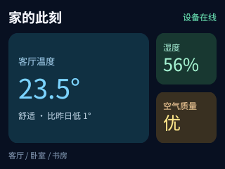

# HTML 布局第一版

`show_html` 接收一个 UTF-8 HTML 片段，通过现有 `DisplayList`、中文字体引擎和 LCD 驱动显示。
布局由片段决定，可以嵌套横排、竖排、比例列和换行行，不限定卡片模板。
这是 `html-layout-v1` 显示语言，不是浏览器；当前不运行 JavaScript，也不加载外部资源。

```json
{
  "name": "show_html",
  "arguments": {
    "html": "<div style='display:flex;height:100%;padding:12px;gap:8px'><p style='flex:2;background:surface;padding:8px'>左侧内容</p><p style='flex:1;background:surface;padding:8px'>右侧</p></div>",
    "persist": false
  }
}
```

`get_display_info` 的 `html_layout` 字段提供完整能力描述。成功返回 `html_nodes`、
`html_layout_steps`、`html_text_work`，以及现有的 `render_ms` 和 `warnings`。
其中 `render_ms` 在设备上包含排版和推屏；模拟器的时间会明确标为 host。

## 预览

以下 PNG 是同一套 C++ 代码直接渲染的 320×240 输出，不是浏览器截图或设计稿。

| 嵌套横纵布局 | 左右比例与底部比例条 |
| --- | --- |
|  |  |

| 长中文与独立侧栏 | 标签按可用宽度自动换行 |
| --- | --- |
|  |  |

源文件位于 [`examples/html/`](../examples/html/)。本地生成：

```sh
# 已准备 fonts.bin 和 ArduinoJson 后
tools/sim/render_html_examples.sh

# 单个片段也可直接预览
tools/sim/sim fonts.bin examples/html/nested.html /tmp/nested.png

# 发给已联网设备；HTML 文件默认 persist:false，避免开发时反复写 Flash
python3 tools/send.py http://<device-ip>:9000/mcp examples/html/nested.html
```

JSON 文件同样支持 `{"type":"html","html":"...","theme":"paper"}`。
修改内容时重新调用 `show_html`，整屏替换。原有所有显示工具继续保留。
第一版暂不允许在 `show_slides` 中放 HTML，整份含 HTML 的轮播会提前拒绝。

## 支持的语法

标签为 `div`、`p`、`span` 和 `br`。前三者都是**布局盒子**，没有浏览器默认段落间距，
`span` 也不提供行内格式化。一个盒子可以包含纯文本（允许 `br`），或包含子盒子；
不支持混合直接文本和子盒子，请把文本包在 `p`/`span` 中。
允许多个顶层盒子；隐式根节点是占满可用屏幕的纵向块。
要让一个根容器占满屏幕，设置 `height:100%`。

属性仅允许带引号的 `style` 和可选 `id`；`id` 是调试标识，不参与样式选择。
元素必须显式闭合，或使用 `<div/>`；`br`、`br/` 均可。支持 HTML 注释。
源码中的空白折叠为空格；`br` 保留硬换行。
支持 `amp`、`lt`、`gt`、`quot`、`apos`、`nbsp` 以及十进制／十六进制数字实体。

| 属性 | 支持值 |
| --- | --- |
| `display` | `block`（默认纵向流）、`flex` |
| `flex-direction` | `row`（flex 默认）、`column` |
| `flex` | 0–100 的单个非负数；设置 grow=N、shrink=1、basis=0 |
| `flex-grow` / `flex-shrink` | 0–100，默认分别为 0 / 1 |
| `flex-basis` | `auto`、px、百分比 |
| `flex-wrap` | `nowrap` 或 `wrap`，换行仅用于横向 flex |
| `gap` | 0–128 px；换行时也作为行间距 |
| `justify-content` | `start` / `flex-start`、`center`、`end` / `flex-end`、`space-between`、`space-around`、`space-evenly` |
| `align-items` / `align-self` | `start` / `flex-start`、`center`、`end` / `flex-end`、`stretch`；self 另支持 `auto` |
| `width` / `height` | `auto`、0–1024 px、0–100% |
| `min-width` / `max-width` / `min-height` / `max-height` | 0–1024 px、0–100% |
| `padding` | 1–4 个 0–128 px 值，按 CSS 上右下左规则展开 |
| `padding-top/right/bottom/left` | 0–128 px |
| `background` / `background-color` / `color` / `border-color` | 项目现有颜色语法、主题颜色，或 `transparent`；background 仅纯色 |
| `border-width` / `border-radius` | 分别 0–16 px / 0–128 px；边框颜色需单独设置 |
| `font-size` | 8–64 px，默认 16 px |
| `font-family` | `sans`、`kai`、`display` |
| `font-weight` | `normal` / `400`、`bold` / `700` |
| `line-height` | 无单位倍率，1–2.5，默认 1.3 |
| `text-align` | `left`、`center`、`right` |
| `box-sizing` / `overflow` | 仅支持 `border-box` / `hidden`，且始终采用此语义 |

px 值也允许省略单位。文本颜色、字体、字号、粗细、行高和文本对齐继承父盒子，其他属性不继承。
不支持属性简写 `border`，请分别设置颜色、宽度。

## 与浏览器不同的边界

- 所有宽高都是 border-box，包括 padding 和边框；最小尺寸至少容纳 padding 和边框。
- flex 分配剩余空间，达到 min/max 的项目固定后继续分配；默认不使用浏览器的 min-content 最小宽度。
  `flex:2` / `flex:1` 在无额外 padding/min/max 时给出 2:1；不同内边距或约束会影响最终外框比例。
- 自动宽度的横排项目采用内容测量宽度；纵排默认横向拉伸。
  高度自动的纵向容器按内容计算，只有取得确定高度后才按 grow 分配竖向空间。
- 百分比相对父容器内容区域；百分比高度和竖向 basis 需要可确定的父高度，不能依赖循环的自动高度。
- 行换行先按 basis/尺寸约束分行，再在每行分配剩余宽度；各行按内容高度从上到下排列。
  不支持 `align-content`、反向排列、排序或 Grid。
- 中文和英文在分配到的宽度内换行；高度不足则截断并显示省略号，返回 overflow warning。
  小到放不下一行的区域不显示文字；第一版不自动缩字号、滚动或分页。
- 子内容裁剪到祖先的内容矩形，不会盖住相邻盒子。圆角用于背景和边框，**不提供圆角形状的子内容裁剪**。
- 不支持行内富文本、CSS 选择器、class、style 标签、margin、定位、图片、SVG、动画、事件或脚本。
  未知属性、标签、CSS 值都会报错，不会静默忽略。原有 `show_text` 的富文本标记在 HTML 中按原文显示。

## 输入与资源限制

| 限制 | 第一版上限 |
| --- | --- |
| HTML UTF-8 字节 | 12,288 |
| 节点 | 96（包含隐式根节点） |
| 元素嵌套深度 | 12 |
| 总文本 | 2,048 个 Unicode 码点 |
| 布局工作计数 | 4,096 |
| 所有文本测量累计码点 | 65,536 |
| HTTP MCP 请求体 | 16,384 字节，含 JSON 转义和协议字段 |
| NVS 持久化 | 整个序列化屏幕描述 6,144 字节 |

默认 `persist:true`。超过持久化上限的常驻 HTML 请求会在换屏前拒绝，并提示改用 `persist:false`。
定时内容不持久化。节点表使用项目现有 `GfxAllocator` 优先分配到 PSRAM，但并非所有临时分配都在 PSRAM。

解析和布局在显示任务中完成；成功构建整份绘制命令之后才推屏。解析、约束或工作量错误会保留
此前的屏幕内容和持久化记录。文本溢出是带 warning 的成功显示，不作为错误回退。
输入仅能构造受限布局，没有脚本执行、事件调用、网络加载或文件读取路径。
这些限制不能替代 MCP 服务自身的访问控制。

## 验证

```sh
tools/tests/run_html_tests.sh
SANITIZE=1 tools/tests/run_html_tests.sh
```

测试覆盖精确坐标、比例、横纵嵌套、min/max 重新分配、换行、对齐、中文、实体、输入上限、
非法语法、失败时不发布部分画面、整帧与不同条带高度的裁剪一致性，以及固定随机种子的输入变异。
板端性能、实际内部堆和 PSRAM 峰值仍需烧录后的测量，不能从 host 耗时或进程 RSS 推断。

`html_mcp_test` 编译实际 `DisplayTools.cpp`，使用内存中的 MCP 注册表和主机显示服务替身，
调用真正的 `show_html` handler，再进入真实 `SceneBuilder` 和像素渲染代码。
它验证必填参数／类型／字节限制、工具场景类型、公共参数透传、错误返回、旧画面保留、
溢出警告及 `get_display_info` 的能力描述。它不模拟或验证 HTTP、BLE、FreeRTOS 队列或 LCD 硬件。

本轮主机验证（2026-10-26）：

- 45 个解析／布局案例与 600 次固定种子的输入变异通过；MCP 注册和 handler 集成测试通过。
- AddressSanitizer 和 UndefinedBehaviorSanitizer 检查通过；未报告运行时内存或未定义行为错误。
- 现有 JSON 示例（含轮播各张，长文取第一页）共 20 张 PNG 与改动前版本逐字节一致。
- 四组预览为 9–18 个节点，33–80 个布局工作单位，180–561 个累计测量码点；
  一次主机运行约 1.8–2.3 ms，字形缓存记账 11–25 KiB。
- 四个独立模拟器子进程记录的最大 RSS 为 18,408 KiB，包含字体文件加载、模拟器和 C++ 运行时，
  **不是 HTML 引擎独占内存，也不是板端 PSRAM 占用**。
- 固件构建尚未完成：PlatformIO 下载 `toolchain-xtensa-esp-elf` 时，镜像
  `usc1.contabostorage.com` 被网络策略返回 403，重试后超时。未更改网络权限或尝试绕过。
- 未运行实体设备 HTTP MCP、LCD、NVS 恢复与板端堆峰值测试；未烧录。
